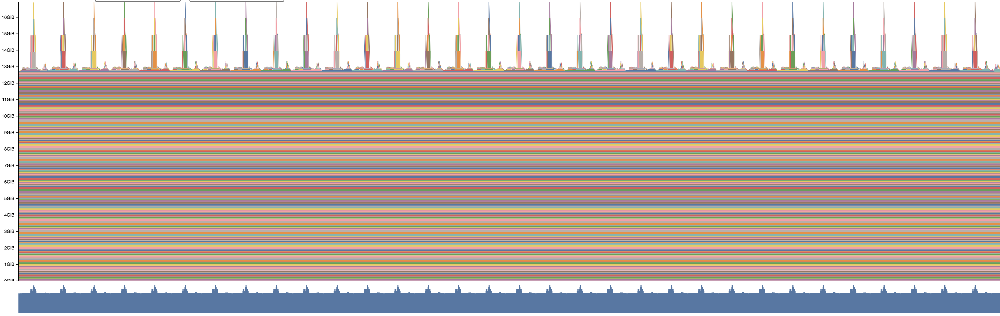
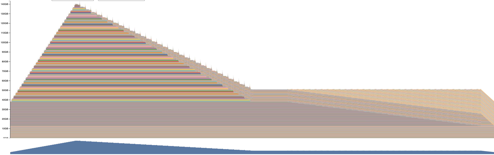

# CS336 Spring 2026 Assignment 2: Systems

For a full description of the assignment, see the assignment handout at
[cs336_assignment2_systems.pdf](./cs336_assignment2_systems.pdf)

If you see any issues with the assignment handout or code, please feel free to
raise a GitHub issue or open a pull request with a fix.

## Setup

This directory is organized as follows:

- [`./cs336-basics`](./cs336-basics): directory containing a module
  `cs336_basics` and its associated `pyproject.toml`. This module contains the staff 
  implementation of the language model from assignment 1. If you want to use your own 
  implementation, you can replace this directory with your own implementation.
- [`./cs336_systems`](./cs336_systems): This folder is basically empty! This is the
  module where you will implement your optimized Transformer language model. 
  Feel free to take whatever code you need from assignment 1 (in `cs336-basics`) and copy it 
  over as a starting point. In addition, you will implement distributed training and
  optimization in this module.

Visually, it should look something like:

``` sh
.
├── cs336_basics  # A python module named cs336_basics
│   ├── __init__.py
│   └── ... other files in the cs336_basics module, taken from assignment 1 ...
├── cs336_systems  # TODO(you): code that you'll write for assignment 2 
│   ├── __init__.py
│   └── ... TODO(you): any other files or folders you need for assignment 2 ...
├── README.md
├── pyproject.toml
└── ... TODO(you): other files or folders you need for assignment 2 ...
```

If you would like to use your own implementation of assignment 1, replace the `cs336-basics`
directory with your own implementation, or edit the outer `pyproject.toml` file to point to your
own implementation.

0. We use `uv` to manage dependencies. You can verify that the code from the `cs336-basics`
package is accessible by running:

```sh
$ uv run python
Using CPython 3.13.13
Creating virtual environment at: /path/to/uv/env/dir
      Built cs336-systems @ file:///path/to/systems/dir
      Built cs336-basics @ file:///path/to/basics/dir
Installed 78 packages in 168ms
Python 3.13.13 (main, Apr  7 2026, 20:49:46) [Clang 22.1.1 ] on linux
Type "help", "copyright", "credits" or "license" for more information.
>>> import cs336_basics
...
```

`uv run` installs dependencies automatically as dictated in the `pyproject.toml` file.

## Submitting

To submit, run `./test_and_make_submission.sh` . This script will install your
code's dependencies, run tests, and create a gzipped tarball with the output. We
should be able to unzip your submitted tarball and run
`./test_and_make_submission.sh` to verify your test results.

## Answers to questions

### `benchmarking_script`

#### (b) Time the forward, backward, and optimizer step for the model sizes described in Section 2.1.2. Use 5 warmup steps and compute the average and standard deviation of timings over 10 measurement steps. How long does a forward pass take? How about a backward pass? Do you see high variability across measurements, or is the standard deviation small?

The requested timings are as follows:

| model_size   |   warmup_steps |   measurement_steps |        forward_ms |        backward_ms |      optimizer_ms |
|:-------------|---------------:|--------------------:|------------------:|-------------------:|------------------:|
| small        |              5 |                  10 |    16.815 ± 0.129 |     32.585 ± 0.196 |    10.557 ± 0.216 |
| medium       |              5 |                  10 |    47.437 ± 0.070 |     92.925 ± 0.157 |    22.554 ± 0.264 |
| large        |              5 |                  10 |   106.996 ± 0.205 |    209.705 ± 0.523 |    40.148 ± 0.776 |
| xl           |              5 |                  10 |   297.860 ± 0.389 |    573.817 ± 0.605 |   101.431 ± 0.670 |
| 10B          |              5 |                  10 |   946.325 ± 0.146 |   1874.216 ± 1.121 |           OOM     |

The backward pass consistently takes approximately twice as long as the forward pass.  The optimization step for the largest 10B model causes a B200 GPU to run out of memory.  The variability across measurements is fairly low, and the standard deviations are small.

#### (c) One caveat of benchmarking is not performing the warm-up steps. Repeat your analysis without the warm-up steps. How does this affect your results? Why do you think this happens? Also try to run the script with 1 or 2 warm-up steps. Why might the result still be different?

Without any warm-up steps, the requested timings are as follows:

| model_size   |   warmup_steps |   measurement_steps |         forward_ms |         backward_ms |        optimizer_ms |
|:-------------|---------------:|--------------------:|-------------------:|--------------------:|--------------------:|
| small        |              0 |                  10 |    44.634 ± 83.586 |     46.652 ± 38.114 |     11.773 ±  2.571 |
| medium       |              0 |                  10 |    51.160 ± 11.283 |     95.261 ±  6.397 |     21.773 ±  0.406 |
| large        |              0 |                  10 |   106.850 ±  0.179 |    208.883 ±  0.402 |     39.893 ±  0.553 |
| xl           |              0 |                  10 |   298.507 ±  3.021 |    572.129 ±  1.005 |    106.728 ± 19.855 |
| 10B          |              0 |                  10 |   946.147 ±  0.300 |   1872.303 ±  1.217 |             OOM     |

The standard deviations, especially for the `small` and `medium` models, are significantly higher than with warm-up steps.  This is because the first few iterations (especially the first iteration) take much longer, owing to the need to allocate memory, load kernels and modules, initialize CUDA libraries, and populate caches.  These warm-up steps are more noticeable for the `small` and `medium` models because they run first, meaning that Modal might be reusing a warm container for the larger models after the smaller models have completed.

With one warm-up step, the requested timings are as follows:

| model_size   |   warmup_steps |   measurement_steps |        forward_ms |        backward_ms |       optimizer_ms |
|:-------------|---------------:|--------------------:|------------------:|-------------------:|-------------------:|
| small        |              1 |                  10 |    20.218 ± 9.064 |     32.621 ± 0.158 |     16.692 ± 0.056 |
| medium       |              1 |                  10 |    48.533 ± 2.446 |     93.601 ± 0.442 |     32.388 ± 0.186 |
| large        |              1 |                  10 |   106.721 ± 0.071 |    209.391 ± 0.559 |     50.050 ± 0.257 |
| xl           |              1 |                  10 |   294.791 ± 0.650 |    572.191 ± 1.027 |    101.181 ± 0.254 |
| 10B          |              1 |                  10 |   945.603 ± 0.270 |   1871.444 ± 0.870 |            OOM     |

Some of the standard deviations, particularly for the `small` and `medium` model forward passes, are still higher than with five warm-up steps, though the huge initial cold-start cost is no longer present.  It is possible that CUDA, kernel, and module caches are not fully established after a single step, so there is still a small warm-up cost for the earlier measurement steps compared to the later measurement steps.

### `nys_profile`

#### (a) What is the total time spent on your forward pass? Does it match what we had measured before with the Python standard library?

| model_size | context_length | forward_ms |
|:-----------|---------------:|-----------:|
| small      |  256           |  26.338    |
| small      |  512           |  23.792    |
| small      | 1024           |  38.779    |
| xl         |  256           | 158.757    |
| xl         |  512           | 297.804    |
| xl         | 1024           | 587.743    |

For the `xl` model, the timing for `context_length = 512` is quite close, but for the `small` model, the timing here is longer, likely because of the overhead of running the profiler itself.

#### (b) What CUDA kernel takes the most cumulative GPU time during the forward pass? How many times is this kernel invoked during a single forward pass of your model? Is it the same kernel that takes the most runtime when you do both forward and backward passes?

For the forward pass, we have:

| model_size | context_length | longest_kernel                                                                               | times_invoked |
|:-----------|---------------:|---------------------------------------------------------------------------------------------:|--------------:|
| small      |  256           | `cutlass3x_sm100_simt_sgemm_f32_f32_f32_f32_f32_64x64x16_1x1x1_3_tnn_align1_bias_f32_relu`   |  24           |
| small      |  512           | `cutlass3x_sm100_simt_sgemm_f32_f32_f32_f32_f32_64x128x16_1x1x1_3_tnn_align1_bias_f32_relu`  |  25           |
| small      | 1024           | `cutlass3x_sm100_simt_sgemm_f32_f32_f32_f32_f32_64x64x16_1x1x1_3_tnn_align1_bias_f32_relu`   |  60           |
| xl         |  256           | `cutlass3x_sm100_simt_sgemm_f32_f32_f32_f32_f32_128x64x16_1x1x1_3_tnn_align1_bias_f32_relu`  |  97           |
| xl         |  512           | `cutlass3x_sm100_simt_sgemm_f32_f32_f32_f32_f32_128x128x16_1x1x1_3_tnn_align1_bias_f32_relu` |  65           |
| xl         | 1024           | `cutlass3x_sm100_simt_sgemm_f32_f32_f32_f32_f32_128x64x16_1x1x1_3_tnn_align1_bias_f32_relu`  | 160           |

For the forward and backward pass, we have:

| model_size | context_length | longest_kernel                                                                               | times_invoked |
|:-----------|---------------:|---------------------------------------------------------------------------------------------:|--------------:|
| small      |  256           | `cutlass3x_sm100_simt_sgemm_f32_f32_f32_f32_f32_128x64x16_1x1x1_3_nnn_align1_bias_f32_relu`  |  72           |
| small      |  512           | `cutlass3x_sm100_simt_sgemm_f32_f32_f32_f32_f32_64x64x16_1x1x1_3_nnn_align1_bias_f32_relu`   | 109           |
| small      | 1024           | `cutlass3x_sm100_simt_sgemm_f32_f32_f32_f32_f32_64x64x16_1x1x1_3_nnn_align1_bias_f32_relu`   |  73           |
| xl         |  256           | `cutlass3x_sm100_simt_sgemm_f32_f32_f32_f32_f32_128x128x16_1x1x1_3_ntn_align1_bias_f32_relu` |  97           |
| xl         |  512           | `cutlass3x_sm100_simt_sgemm_f32_f32_f32_f32_f32_64x64x16_1x1x1_3_nnn_align1_bias_f32_relu`   | 193           |
| xl         | 1024           | `cutlass3x_sm100_simt_sgemm_f32_f32_f32_f32_f32_128x64x16_1x1x1_3_nnn_align1_bias_f32_relu`  | 193           |

All of these are matrix multiplication kernels, but they are for matrices of different sizes.  For some model sizes and context lengths, the kernel that takes the most GPU time for forward-only and forward-and-backward passes are the same, but for others, the kernel is different.

#### (c) Although the vast majority of FLOPs take place in matrix multiplications, you will notice that several other kernels still take a non-trivial amount of the overall runtime. What other kernels besides matrix multiplies do you see accounting for non-trivial CUDA runtime in the forward pass?

Some other kernels besides matrix multiplies that account for non-trivial CUDA runtime in the forward pass are:

- `void at::native::elementwise_kernel<(int)128, (int)2, void at::native::gpu_kernel_impl_nocast<at::native::BinaryFunctor<float, float, float, at::native::binary_internal::DivFunctor<float>>>(at::TensorIteratorBase &, const T1 &)::[lambda(int) (instance 1)]>(int, T3)`
- `void at::native::elementwise_kernel<(int)128, (int)2, void at::native::gpu_kernel_impl_nocast<at::native::<unnamed>::where_kernel_impl(at::TensorIterator &)::[lambda() (instance 1)]::operator ()() const::[lambda() (instance 11)]::operator ()() const::[lambda(bool, float, float) (instance 1)]>(at::TensorIteratorBase &, const T1 &)::[lambda(int) (instance 1)]>(int, T3)`
- `void at::native::elementwise_kernel<(int)128, (int)2, void at::native::gpu_kernel_impl_nocast<at::native::CUDAFunctor_add<float>>(at::TensorIteratorBase &, const T1 &)::[lambda(int) (instance 1)]>(int, T3)`

These are elementwise operations: the first is for elementwise division, the second is for `torch.where` used in masking, and the third is for elementwise addition.  These elementwise kernels account for a larger percentage of the runtime in the `small` model compared to the `xl` model.

#### (d) Profile running one complete training step with your implementation of AdamW (i.e., the forward pass, computing the loss and running a backward pass, and finally an optimizer step, as you'd do during training). How does the fraction of time spent on matrix multiplication change, compared to doing inference (forward pass only)? How about other kernels?

For the forward pass, we have:

| model_size | context_length | matrix_multiplication_fraction |
|:-----------|---------------:|-------------------------------:|
| small      |  256           |  0.772                         |
| small      |  512           |  0.759                         |
| small      | 1024           |  0.689                         |
| xl         |  256           |  0.930                         |
| xl         |  512           |  0.906                         |
| xl         | 1024           |  0.862                         |

For the full training step, we have:

| model_size | context_length | matrix_multiplication_fraction |
|:-----------|---------------:|-------------------------------:|
| small      |  256           |  0.581                         |
| small      |  512           |  0.642                         |
| small      | 1024           |  0.629                         |
| xl         |  256           |  0.744                         |
| xl         |  512           |  0.803                         |
| xl         | 1024           |  0.812                         |

The fraction of time spent on matrix multiplication decreases for the full training step compared to the forward pass, at least in part because the AdamW optimization step consists almost entirely of elementwise operations.  Note also that the fraction of matrix multiplication is higher for a larger model size.

#### (e) Compare the runtime of the softmax operation versus the matrix multiplication operations within the self-attention layer of your model during a forward pass. How does the difference in runtimes compare to the difference in FLOPs?

We have:

| model_size | context_length | matrix_multiplication_mean_µs | softmax_mean_µs |
|:-----------|---------------:|------------------------------:|----------------:|
| small      |  256           |    72.828                     |   80.900        |
| small      |  512           |   131.359                     |  133.680        |
| small      | 1024           |   428.450                     |  479.059        |
| xl         |  256           |   108.286                     |   94.778        |
| xl         |  512           |   361.932                     |  340.982        |
| xl         | 1024           |  1303.744                     | 1254            |

The runtimes are comparable for matrix multiplication and softmax, but the number of operations in each layer for matrix multiplication is about `4 * context_length * context_length * d_model` while the number of operations in each layer for softmax is about `5 * context_length * context_length * num_heads`.  Thus, the ratio of FLOPS for matrix multiplication to FLOPs for softmax is `4 * d_model / (5 * num_heads)` which is much greater than 1.  (For the `small` model the ratio is about 51.2 and for the `xl` model the ratio is about 64.)

The reason for comparable runtimes despite many more matrix multiplication FLOPs is that matrix multiplication has much higher arithmetic intensity through data reuse; thus it is much more efficient on the GPU.  Softmax is less efficient, involving the launching of many different kernels and more frequent reading and writing from memory.

### `mixed_precision_accumulation`
#### Run the following code and comment on the accuracy of the results.
```
    s = torch.tensor(0,dtype=torch.float32)
    for i in range(1000):
        s += torch.tensor(0.01,dtype=torch.float32)
    print(s)

    s = torch.tensor(0,dtype=torch.float16)
    for i in range(1000):
        s += torch.tensor(0.01,dtype=torch.float16)
    print(s)

    s = torch.tensor(0,dtype=torch.float32)
    for i in range(1000):
        s += torch.tensor(0.01,dtype=torch.float16)
    print(s)

    s = torch.tensor(0,dtype=torch.float32)
    for i in range(1000):
        x = torch.tensor(0.01,dtype=torch.float16)
        s += x.type(torch.float32)
    print(s)
```

With infinite precision, the correct answer would be `10`.  The first block of code in FP32 gives `10.0001`, which is quite accurate.  The second block of code in FP16 gives `9.9531`, which is a significant loss in accuracy.  The third and fourth blocks of code evaluate 0.01 in FP16 but accumulate in FP32, and both yield an answer of `10.0021`, which is much closer to the correct answer and to the answer obtained fully using FP32.

This is because although there is some error in evaluating `0.01` in FP16 (the value is actually `0.01000213623046875`), there is no additional error introduced in accumulation when the accumulation is done in FP32.  In contrast, accumulating in FP16 causes rounding error at every step of the accumulation.

### `benchmarking_mixed_precision`
#### (a) Consider the following model:
```
class ToyModel(nn.Module):
    def __init__(self, in_features: int, out_features: int):
        super().__init__()
        self.fc1 = nn.Linear(in_features, 10, bias=False)
        self.ln = nn.LayerNorm(10)
        self.fc2 = nn.Linear(10, out_features, bias=False)
        self.relu = nn.ReLU()
    def forward(self, x):
        x = self.relu(self.fc1(x))
        x = self.ln(x)
        x = self.fc2(x)
        return x
```
Suppose we are training the model on a GPU and that the model parameters are originally in 
FP32.  We'd like to use autocasting mixed precision with FP16.  What are the data types of:
- the model parameters within the autocast context? `torch.float32`
- the output of the first feed-forward layer (`ToyModel.fc1`)? `torch.float16`
- the output of layer norm (`ToyModel.ln`)? `torch.float32`
- the model's predicted logits? `torch.float16`
- the loss? `torch.float32`
- the model's gradients? `torch.float32`

#### (b) You should have seen that FP16 mixed precision autocasting treats the layer normalization layer differently than the feed-forward layers.  What parts of layer normalization are sensitive to mixed precision?  If we use BF16 instead of FP16, do we still need to treat layer normalization differently?  Why or why not?

Using FP16 mixed precision treats layer normalization using FP32 because normalizing the activations within a layer involves calculating a mean and standard deviation, which in turn involves accumulating the activations or the squared activations.  These accumulations are sensitive to rounding error and need to be done in FP32.  Squaring large activations could also overflow in FP16.

If we use BF16 instead of FP16, the layer normalization would still need to be done in FP32 because BF16 has the same _range_ as FP32 but a much lower _precision_ than FP32 (and even than FP16).  So BF16 would address the range problem with squaring large activations, but not the precision problems with rounding error in accumulations.  Thus, layer normalization should still be done in FP32.

#### (c) Modify your benchmarking script to optionally run the model using mixed precision with BF16. Time the forward and backward passes with and without mixed-precision for each language model size described in Section 2.1.2. Compare the results of using full precision versus mixed precision, and comment on any trends as model size changes. You may find the nullcontext no-op context manager to be useful.

The requested timings are as follows:

| model_size   | mixed_precision   |   warmup_steps |   measurement_steps |        forward_ms |        backward_ms |      optimizer_ms |
|:-------------|:------------------|---------------:|--------------------:|------------------:|-------------------:|------------------:|
| small        | no                |              5 |                  10 |    15.828 ± 0.104 |     30.287 ± 0.170 |     8.752 ± 0.497 |
| small        | yes               |              5 |                  10 |     7.536 ± 0.340 |     12.149 ± 1.254 |     8.508 ± 0.264 |
| medium       | no                |              5 |                  10 |    45.867 ± 0.102 |     88.833 ± 0.087 |    17.337 ± 0.716 |
| medium       | yes               |              5 |                  10 |    15.167 ± 0.330 |     28.610 ± 0.091 |    16.828 ± 0.366 |
| large        | no                |              5 |                  10 |   103.928 ± 0.144 |    202.709 ± 0.591 |    31.075 ± 0.831 |
| large        | yes               |              5 |                  10 |    27.390 ± 0.162 |     53.901 ± 0.324 |    30.840 ± 0.745 |
| xl           | no                |              5 |                  10 |   290.641 ± 0.294 |    565.041 ± 0.790 |    92.162 ± 0.083 |
| xl           | yes               |              5 |                  10 |    45.460 ± 0.110 |    103.388 ± 1.016 |    92.421 ± 0.314 |
| 10B          | no                |              5 |                  10 |   940.167 ± 0.182 |   1860.255 ± 0.730 |               OOM |
| 10B          | yes               |              5 |                  10 |   110.251 ± 0.421 |    274.890 ± 1.205 |               OOM |

Using mixed precision yields faster forward and backward passes compared to using full precision, and the speedup increases as the model size increases.  In all cases, the backward pass still takes about twice as long as the forward pass.  The optimizer step time is unchanged, since it involves primarily elementwise operations and accumulations which still run using full precision rather than matrix multiplications which can take advantage of the mixed precision.

### `memory_profiling`

#### (a) Profile your complete training step of forward pass, backward pass, and optimizer step of the xl model from Table 1 with context lengths of 128 and 2048.  Then, run your script to get a memory profile of the xl model when either doing inference only (just forward pass) or a full training step. What do your memory timelines look like? Can you tell which stage is running based on the peaks you see?

All memory profiling was done with `batch_size = 2` to avoid running out of memory on the B200 GPU.  Here is the memory timeline for `context_length = 2048` in full precision doing inference only (just forward pass).



The allocations prior to the start of profiling correspond to the parameters (which are already allocated during model construction before the warm-up steps).  As the forward pass proceeds, the memory allocated for computing the activations quickly grows and then decays as the computations are finished.  The tensors needed for a backward pass are not retained because the inference-only path is run with `torch.set_grad_enabled(False)`.

Here is the memory timeline for `context_length = 2048` in full precision doing the full training step (forward pass, backward pass, and optimizer step).



The allocations prior to the start of profiling correspond to the parameters and their first and second moments (from AdamW).  These are already allocated before profiling starts.  As the forward pass proceeds, memory is allocated to the activations and these activations are kept in memory until they are used in the backward pass.  Thus, the forward pass memory starts to be freed during the backward pass, but the gradients are then stored.  By the end of the backward pass, profile flattens and the parameters, first and second moments, and gradients are stored in memory.  During AdamW, the total amount of memory remains roughly unchanged, but we see freeing and allocation that corresponds to the updating of the first and second moments of the parameters.  After AdamW is complete, the gradients are freed when `zero_grad` is called.

#### (b) What is the peak memory usage of each context length when doing a forward pass? What about when doing a full training step?

The peak memory usages in full precision are as follows:

| model_size   |    context_length | mode               |   peak_memory_GiB |
|:-------------|------------------:|:-------------------|------------------:|
| xl           |               128 | forward pass       |              12.7 |
| xl           |               128 | full training step |              51.3 |
| xl           |              2048 | forward pass       |              16.9 |
| xl           |              2048 | full training step |             143.4 |

#### (c) Find the peak memory usage of the xl model when using mixed-precision, for both a forward pass and a full training step. Does mixed-precision significantly affect memory usage?

The peak memory usages in mixed precision are as follows:

| model_size   |    context_length | mode               |   peak_memory_GiB |
|:-------------|------------------:|:-------------------|------------------:|
| xl           |               128 | forward pass       |              19.0 |
| xl           |               128 | full training step |              51.3 |
| xl           |              2048 | forward pass       |              22.0 |
| xl           |              2048 | full training step |             120.0 |

Yes, mixed precision does significantly affect memory usage.  In the forward pass (inference only), mixed precision actually increases memory usage because it creates BF16 cached copies of eligible FP32 matrices for matrix multiplications.  In the full training step, with a short context length of 128, the FP32 parameters, gradients, and AdamW moments dominate over any additional BF16 cached copies, so the total memory usage is approximately the same.  At a long context length of 2048, the memory savings start to become significant in mixed precision because some intermediate activations are only stored in BF16, instead of FP32.

#### (d) Consider the xl model. Given our reference hyperparameters, what is the size of a tensor of activations in the Transformer residual stream, in single-precision? Give this size in MiB (i.e., divide the number of bytes by 1024**2).

A tensor of activations in single precision has a memory size in MiB oif `4 * batch_size * sequence_length * d_model / 1024**2`, where `d_model = 2560` for the `xl` model.  Thus, we have the following values:

| batch_size   |    context_length |    memory_MiB |
|-------------:|------------------:|--------------:|
|            2 |               128 |           2.5 |
|            2 |              2048 |          40.0 |
|            4 |               128 |           5.0 |
|            4 |              2048 |          80.0 |

#### (e) Now look closely at the "Active Memory Timeline" from pytorch.org/memory_viz of a memory snapshot of the xl model doing a forward pass. When you reduce the "Detail" level, the tool hides the smallest allocations to the corresponding level (e.g., putting "Detail" at 10% only shows the 10% largest allocations). What is the size of the largest allocations shown? Looking through the stack trace, can you tell where those allocations come from?

For `context_length = 2048` using full precision, the largest activations are 1.0 GiB.  From the stack traces, these come from the matrices inside the attention mechanism (attention scores, possibly masked, possibly passed through softmax).  The size of these matrices in GiB is:
`4 * batch_size * num_heads * context_length ** 2 / 1024 ** 3` or `4 * 2 * 32 * 2048 ** 2 / 1024 ** 3 = 1.0 GiB`.

#### (f) Nsight Systems also has flags for memory profiling. You can combine these with the Nsight flags from before to understand what allocations are happening at different steps in your model's lifespan. Use the PyTorch-provided NVTX labels to determine how much memory is saved for backward (these tensors are often called residuals) by a single `TransformerBlock` in your model. Note the 5 largest contributing operations, and what percentage of the overall memory they contribute. During the backward pass, all these tensors will be freed, but new gradient tensors are emitted at the same time. Based on your profiles showing how much memory was allocated during the forward pass, and how much memory usage changes for every `TransformerBlock` in the backward pass, calculate how much memory the produced gradient tensors for a TransformerBlock take. Does the result match what you expect?

### `gradient_checkpointing`

#### (a) What checkpointing strategy minimizes peak activation memory, ignoring the compute cost? Describe how you would arrange the checkpoint calls (a code sketch is fine), and give the asymptotic peak activation memory and compute of your strategy as a function of N. Assume the residuals saved by a single block dominate any per-checkpoint bookkeeping.

To minimize peak activation memory, you recursively divide the N blocks into two approximately equally-sized sequences and checkpoint each sequence, and continue until each sequence consists of a single block.  During the backward pass, you recompute each sequence recursively, releasing its tensors as soon as the corresponding backward pass finishes.

Pseudocode looks as follows:
```
def run_group(x, blocks):
  if len(blocks) == 1:
    return blocks[0](x)

  mid = len(blocks) // 2

  left_blocks = blocks[:mid]
  right_blocks = blocks[mid:]

  x = checkpoint(lambda z: run_group(z, left_blocks), x)
  x = checkpoint(lambda z: run_group(z, right_blocks), x)
  return x

output = checkpoint(lambda z: run_group(z, blocks), x)
```

The peak activation memory is `O(log N)`, since the recursion is `log N` levels deep and you have to keep `log N` saved checkpoints in memory at the same time.  (You also have to keep one set of residuals in memory at a time, for the layer you are currently backpropagating through.)

The backpropagation phase satisfies the recursion `T(N) = 2 * T(N/2) + O(N)`, whose solution is `O(N * log N)`.

#### (b) Consider the xl model config with batch size 4 and sequence length 2048 as above. If you only have the time/compute budget to run one step of recomputation (meaning you may not nest checkpoint calls), what is the best checkpointing strategy to reduce peak memory? Profile your run’s peak memory to validate your hypothesis. Compare the peak memory of the next smaller and larger checkpointing block sizes to be sure.